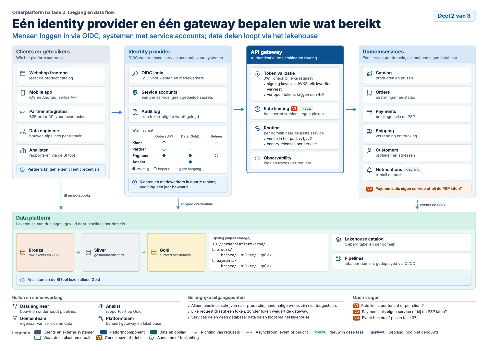
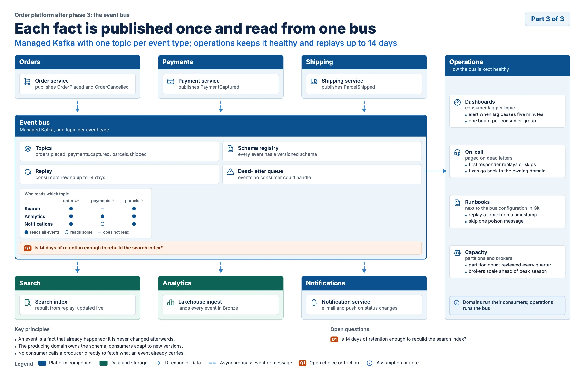
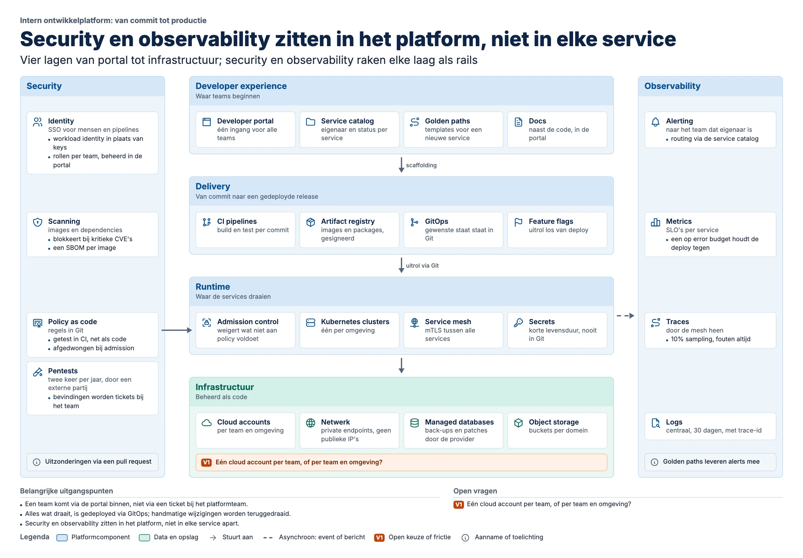
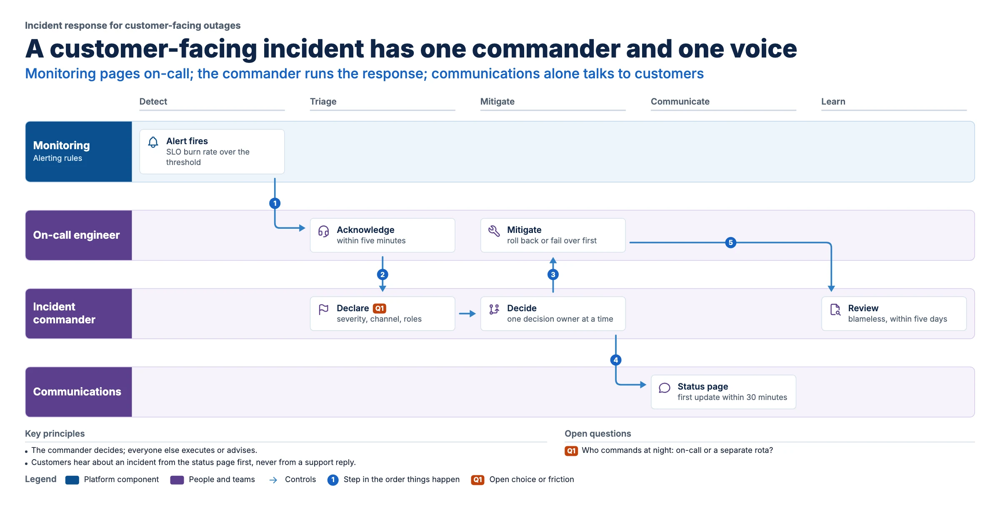
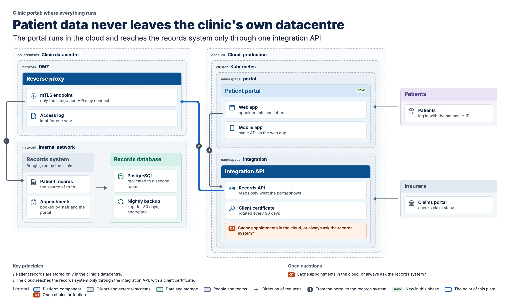
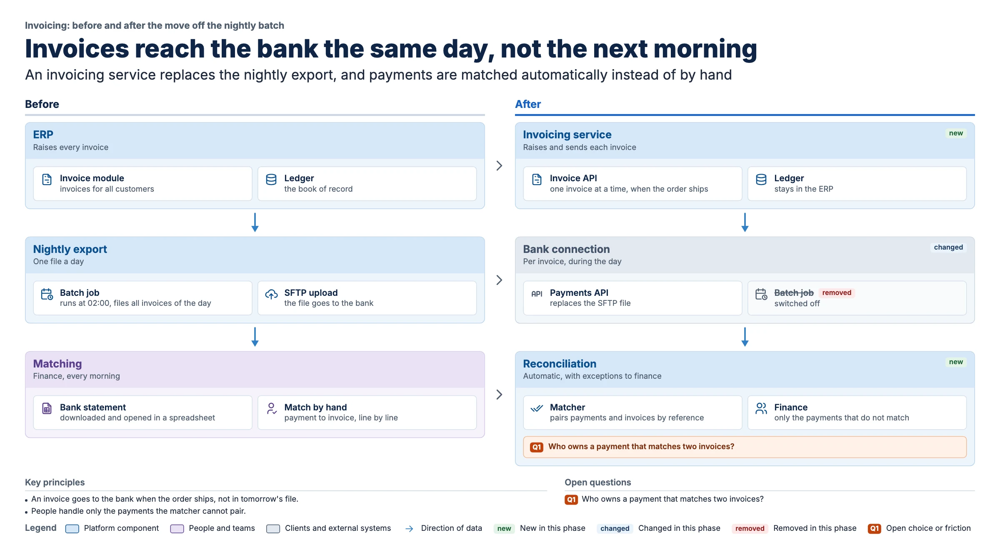
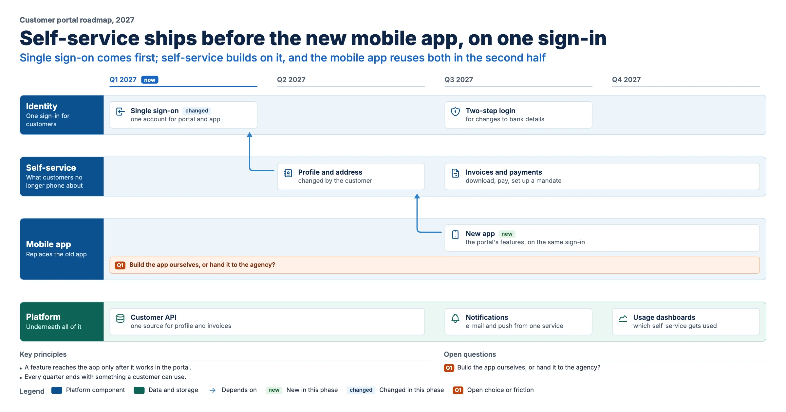

# Schemantic

**From meaning to structure to pixels.** Schemantic turns a description of a system into a finished one-page
architecture plate: a small YAML spec in; a vector SVG, a PNG raster of it, and a text outline out.



## Install as a skill

The repository is a Claude skill: [`SKILL.md`](SKILL.md) takes Claude from notes, a design document, a repository
or a process description to a lint-clean plate. Link the folder into your skills directory:

```bash
ln -s "$PWD" ~/.claude/skills/schemantic
```

Then ask in plain words ("make an architecture plate of these meeting notes"). On first use the skill runs
`scripts/doctor.py`, which uses a Python that already has the dependencies or creates a venv in
`~/.cache/schemantic`. It never writes into the skill folder, so a read-only install works.

## Quickstart

```bash
python3 -m venv .venv && source .venv/bin/activate
pip install -e ".[dev]" && python -m playwright install chromium
python -m schemantic build examples/orderplatform-toegang.yaml --out out
```

`build` checks the spec, lays the plate out in Chromium, routes the connectors, lints the result, and writes
`out/<name>.svg`, `.png` and `.md` (the outline). It prints a JSON report and exits 1 on errors; every finding names
an element and carries a hint. Other commands: `new <archetype> <path>` (a starter spec with TODOs to fill),
`lint`, `doctor`, `icons <word>`, `gallery`, `docs`, `offline`, `verify`, `smoke`; `--review` adds crops of the
plate a model can read. Print with `canvas.size: a3-landscape` and `--dpi 300`; hand off to a design tool with
`--outline-text`; restyle with a theme (`canvas.theme` or `--theme`, see
[`examples/themes/warm.css`](examples/themes/warm.css)).

Rendering needs no network. For a machine without one, `schemantic offline <folder>` writes a kit (pinned and hashed
wheels, Chromium, checksums, an installer with a smoke test); see [`docs/offline.md`](docs/offline.md).

## Gallery

One plate per archetype, each built from a fictional spec in [`examples/`](examples/).

| | |
| --- | --- |
|  **column-flow**: a path, with status tags, a flag and focus |  **hub-and-spokes**: one bus, async flows, a card-to-card connector |
|  **layer-cake**: layers with security and observability rails |  **swimlane**: actors, phases and numbered handoffs |
|  **nested-zones**: where everything runs |  **before-after**: what each part becomes, with change status |
|  **roadmap**: workstreams over quarters, with now marked | |

## The spec in one look

<!-- lint -->
```yaml
canvas:  {size: landscape-4x3, lang: nl, series: orderplatform, part: 2, of: 3}
topic:   "Orderplatform na fase 2: toegang en data flow"
title:   "Eén identity provider en één gateway bepalen wie wat bereikt"
archetype: column-flow
layout:
  areas:
    - "clients identity gateway services"
    - "data    data     data    data"
panels:
  - id: clients
    title: "Clients en gebruikers"
    role: external                     # platform | data | external | actor
    cards:
      - {icon: browser, name: "Webshop frontend", note: "leest de product catalog"}
flows_mean: request
flows:
  - {from: clients, to: identity}
  - {from: identity, to: data, label: "scoped credentials"}   # a label needs a run with room beside it
footer:
  principles:
    - "Klanten, partners en medewerkers loggen in via één identity provider."
    - "Data blijft bij de bron; delen loopt via het lakehouse."
```

The sample is completed against `examples/orderplatform-toegang.yaml` and linted by the tests. The contract is
[`schemantic/schema/plate.schema.json`](schemantic/schema/plate.schema.json) (with editor completion through `yaml-language-server`); the
field guide is [`references/spec-guide.md`](references/spec-guide.md).

## Status

Proof of concept, version 0.2.0 (see [`CHANGELOG.md`](CHANGELOG.md)).

| Built | Planned |
| --- | --- |
| Archetypes: column-flow, hub-and-spokes, layer-cake, swimlane, nested-zones, before-after, roadmap | Archetypes: banded-matrix |
| Patterns: tier strip, process strip, tree, matrix | Patterns: mini sequence, lifecycle loop |
| Connectors: straight, L, Z and U routes; card endpoints; sync, async, optional; steps | |
| Roles, themes, change status, card flags, focus; locales `nl` and `en` | |
| Lint with hints for every check; SVG parity; goldens and snapshots on Linux and macOS | |
| The skill: analysis method, brief and traceability, review questions, evals | |

## How it works

Schemantic works like a compiler. The spec says what the plate holds and how it is composed: the agent picks an
archetype and places panels in words (columns, a hub, layers, lanes, zones), never in pixels. Chromium computes the
geometry of that composition with CSS Grid; page scripts size the canvas, route connectors around the measured boxes
and lint the result. The measured page becomes a layout document (every box, text line, icon and connector, at its
position), and the SVG is written from that document with a subset of the bundled fonts; the PNG is a raster of the
SVG. Styles stay within what the SVG can draw, and lint names anything outside it. Print sizes (A3, A4, `--dpi`) are
there. Every build checks the SVG against Chromium's own rendering, and the tests check it in a second renderer,
librsvg: with `--outline-text` the plate renders the same there, on screen sizes and on paper. Viewers that ignore
fonts embedded in an SVG (librsvg among them, and some design tools) set live text in a system font, so lines can
run longer or shorter; hand those the outlined SVG. PDF export is not there yet. See
[`docs/architecture.md`](docs/architecture.md) for the pipeline and the router, and
[`docs/design-notes.md`](docs/design-notes.md) for why it is built this way.

## Contributing

See [`CONTRIBUTING.md`](CONTRIBUTING.md): setup, tests, the golden and gallery policy, and the rules.

## Licences

- **Code:** MIT, see [`LICENSE`](LICENSE).
- **Icons:** [Tabler Icons](https://tabler.io/icons) 3.19, MIT (`schemantic/icons/LICENSE-tabler-icons.txt`).
- **Fonts:** [Inter](https://rsms.me/inter/) 4.1, SIL Open Font License (`schemantic/fonts/LICENSE-inter.txt`), and
  [DejaVu Sans Mono](https://dejavu-fonts.github.io/) 2.37 (`schemantic/fonts/LICENSE-dejavu.txt`), unmodified; DejaVu
  converted from TTF to WOFF2.
