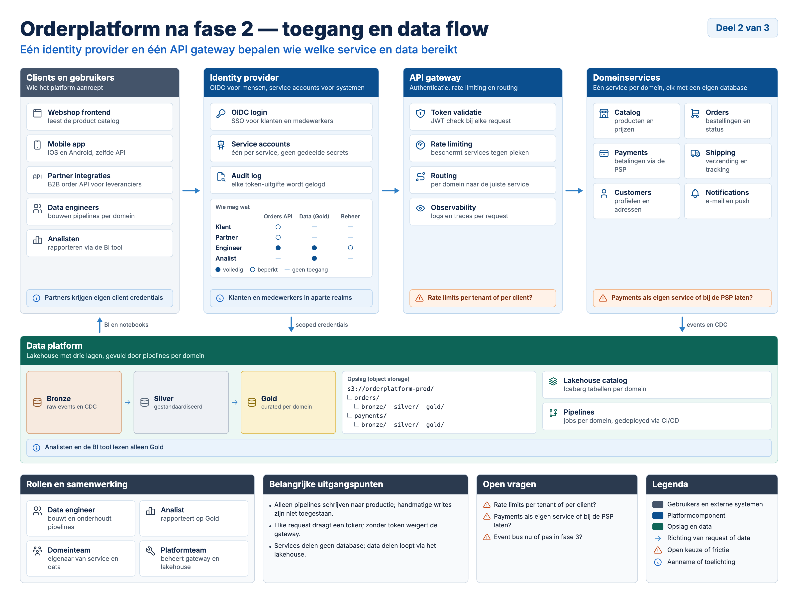
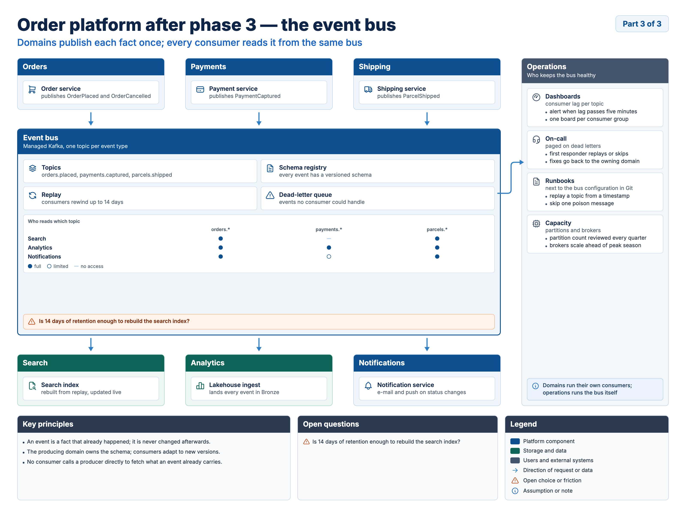
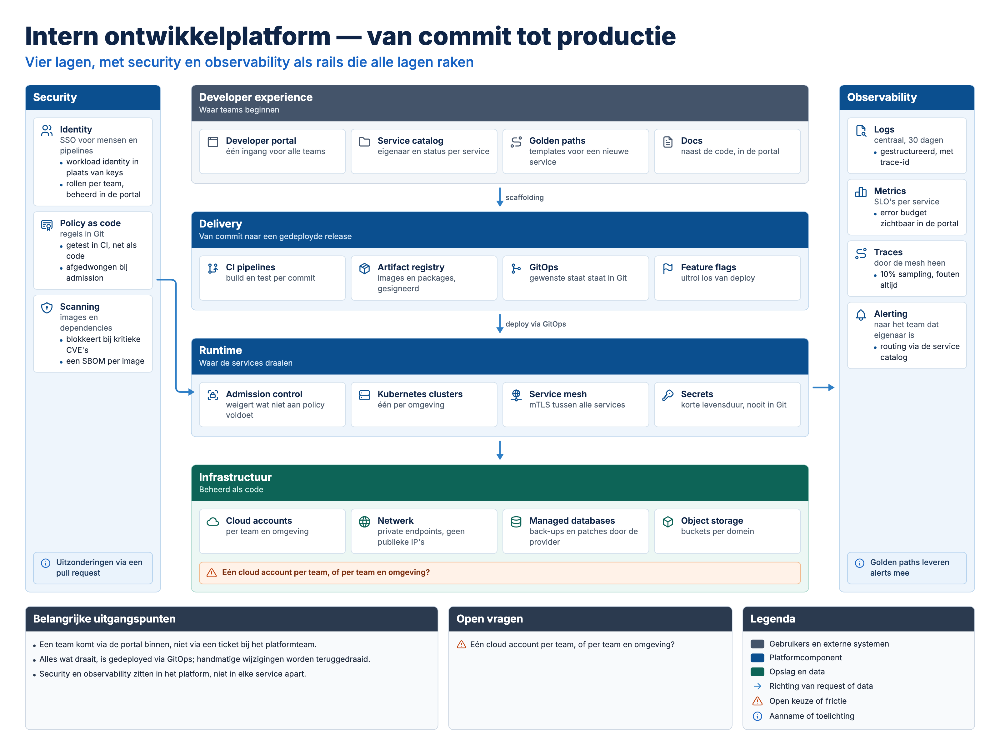

# Schemantic

**From meaning to structure to pixels.**

Schemantic turns an idea into an architecture plate. You describe the system as a
small YAML spec — panels, cards, flows, principles, open questions — and it renders
a finished, print-grade overview plate as **SVG and PNG**.

There are no coordinates in the spec. Chromium does the layout with CSS Grid; a
script measures every box, line and text run, then writes native SVG
(`rect`, `path`, `text`, `line`). The PNG is a raster of that same SVG.

> Status: proof of concept. Three body archetypes (`column-flow`, `hub-and-spokes`,
> `layer-cake`), a connector router and a Claude skill are built end to end; six more
> archetypes are planned.

## Use it as a Claude skill

The repository is a skill: [`SKILL.md`](SKILL.md) takes Claude from a description of a system
to a finished plate. It picks a layout, writes the spec, runs lint, fixes the spec until lint
is clean, renders, and reviews the PNG. Link the folder into your skills directory:

```bash
ln -s "$PWD" ~/.claude/skills/schemantic
```

Then ask for a plate in plain words ("draw our order platform: one gateway, four services,
a data platform underneath"). On first use the skill runs `scripts/doctor.py`, which uses a Python
that already has the dependencies or creates a venv in `~/.cache/schemantic`; it never writes into
the skill folder, so a read-only install works.

## Quickstart

```bash
python3 -m venv .venv && source .venv/bin/activate
pip install -e ".[dev]"
python -m playwright install chromium

python -m schemantic build examples/orderplatform-toegang.yaml --out out
```

`build` checks the spec, lays the plate out in Chromium, routes the connectors, lints the result
and writes `out/<name>.svg` and `out/<name>.png`, in one browser session. It prints a JSON report
and exits `1` on errors; every finding has a `hint`. `lint` does the same without writing the
deliverables; `doctor` finds a working Python and Chromium; `icons <word>` searches the icons;
`docs` regenerates `references/lint-fixes.md`. Intermediate files land in `out/_work/`.

Needs Python 3.9+ (tested on 3.9 and 3.14) and Playwright 1.60 or later; `pyproject.toml` lists
the rest. `scripts/render.py` and `scripts/lint.py` still work but are deprecated shims.

`column-flow`, `hub-and-spokes` and `layer-cake` are built. The schema lists the other
archetypes as the planned contract, but render and lint refuse them with an `archetype` error
until they exist. [`references/archetypes.md`](references/archetypes.md) describes each layout.

## Tests

```bash
python -m pytest -q                   # spec, checks, router, docs, snapshots and goldens
python -m pytest -q --update-golden   # after an intended visual change; review and commit them
```

Every example in `examples/` is rendered and compared twice. The image is compared with
`tests/golden/<name>.png` after a 1.5 px blur, failing when any one region or 32 × 32 tile
differs, so sub-pixel noise passes and a one-character change fails. The structure (every
element box, text line and connector, within 2 px) is compared with `tests/snapshots/<name>.json`,
and a failure names the element that changed. The goldens were rendered on macOS with the versions in
`tests/golden/VERSION`; the suite also passes with Python 3.9, Playwright 1.60 and Chromium 148.

Fonts are bundled in `assets/fonts/` (Inter, and DejaVu Sans Mono for paths), so nothing
needs to be installed and every machine lays the plate out the same way. The HTML loads
the full files through `@font-face`; the SVG embeds a WOFF2 subset of the glyphs it draws,
so it renders the same in any browser. Tools that ignore `@font-face` in SVG (Inkscape,
Cairo) still need Inter installed.

## Why it is built this way

HTML-to-SVG converters in the Satori style have no CSS Grid. Measuring in a real
browser and emitting SVG from the measured geometry works, and the result renders
identically in Cairo (Inkscape's renderer) and Chromium.

## What is built

| Part | Status |
| --- | --- |
| Canvas frame: title block, part badge, footer (context, principles, open questions, legend) | Built |
| Body archetype: column flow, with spanning areas over several rows | Built |
| Body archetype: hub and spokes (up to 4 above, 4 below, one each side; framed hub) | Built |
| Body archetype: layer cake (2–5 layers, rails left and right) | Built |
| Components: panel (role colours), card, bullets, warning and info chips | Built |
| Panel patterns: tier strip, tree, matrix | Built |
| Connectors: panel or card endpoints; straight, or one or two rounded bends through the gutters; one- or two-way; labels beside or above any run with room | Built |
| Locales `nl` (default, English technical terms) and `en` | Built |
| Lint: schema, built archetype, layout keys, areas, flow endpoints, chip mirror, icons, never-translate terms (substring, for Dutch compounds), text overflow, containment, overlap, canvas fit, type floor, contrast, arrow routing (panels and cards), arrow labels, chip length, density, SVG parity | Built |
| `SKILL.md` and `references/` (archetypes, spec guide, lint fixes, review questions) | Built |
| Other six body archetypes; process strip, mini sequence, lifecycle loop | Not yet |
| Text-as-outlines SVG | Not yet |

## Layout of the folder

```text
SKILL.md                 the skill: description to finished plate
references/              archetypes, spec guide, lint fixes, review questions (read by the skill)
schema/plate.schema.json spec contract
locales/                 fixed labels per language, never-translate list
templates/               plate.html.j2, tokens.css (theme, override per project), components.css
assets/icons/            57 Tabler outline icons (MIT, see LICENSE-tabler-icons.txt)
assets/fonts/            Inter 4.1 (400–800) and DejaVu Sans Mono 2.37, with their licences
schemantic/              the package: spec, archetypes/ (one module per layout), html, browser, route,
                         export, lint, images, findings, pipeline, cli, doctor; js/ holds the page scripts
scripts/                 plate.py and doctor.py for the skill; render.py and lint.py are deprecated shims
examples/                fictional plates (spec only; renders go to out/)
tests/                   pytest suite; golden/ holds the reference render of each example
```

## Spec in one look

<!-- lint -->
```yaml
canvas:  {size: landscape-4x3, lang: nl, series: orderplatform, part: 2, of: 3}
title:   "Orderplatform na fase 2 — toegang en data flow"
archetype: column-flow
layout:
  areas:
    - "clients identity gateway services"
    - "data    data     data    data"
panels:
  - id: clients
    title: "Clients en gebruikers"
    role: external                     # platform | storage | external
    cards:
      - {icon: browser, name: "Webshop frontend", note: "leest de product catalog"}
flows:
  - {from: clients, to: identity}
  - {from: identity, to: data, label: "scoped credentials"}   # a label needs a run with room beside it
footer:
  principles:
    - "Klanten, partners en medewerkers loggen in via één identity provider."
    - "Data blijft bij de bron; delen loopt via het lakehouse."
```

The sample is completed against `examples/orderplatform-toegang.yaml` and linted by the test suite.
The full contract lives in [`schema/plate.schema.json`](schema/plate.schema.json).

## Example output



Rendered from [`examples/orderplatform-toegang.yaml`](examples/orderplatform-toegang.yaml)
(`column-flow`, `nl`, part 2 of 3).



Rendered from [`examples/orderplatform-eventbus.yaml`](examples/orderplatform-eventbus.yaml)
(`hub-and-spokes`, `en`, part 3 of 3). The dead-letter queue connects card to card, turning
through the gutter into the operations spoke.



Rendered from [`examples/ontwikkelplatform-lagen.yaml`](examples/ontwikkelplatform-lagen.yaml)
(`layer-cake`, `nl`), with security and observability as rails.


## Findings from building it

- Satori-style HTML-to-SVG converters lack CSS Grid; measuring in Chromium and emitting SVG works and
  renders the same in Cairo (Inkscape's renderer) as in Chromium.
- Pixel-exact parity is the wrong test: Chromium snaps HTML text to whole pixels, SVG keeps fractions
  (0.9 % of pixels differ with no visible change). After a 1.5 px blur a correct plate scores 0 and a
  plate with one card deleted scores about 4,600 pixels, so the check is structural.
- Density below 0.6 matched the one panel that looked empty on review; the fix was content, not layout.
- A long Dutch word ("gestandaardiseerd") overflowed a tier tile; lint caught it, block weights fixed it.
- Connectors are routed against measured boxes, not drawn from the spec. A rail card connected to the
  card at the far end of a layer had no clear route; lint said so, and the fix was card order in the spec.
- Text baselines must be measured at the real font size: a 100 px probe scaled down drifted by a pixel
  once Inter replaced the system font, enough to fail parity on bold titles.

## Icons

The outline icon set in `assets/icons/` is [Tabler Icons](https://tabler.io/icons), MIT licensed —
see `assets/icons/LICENSE-tabler-icons.txt`.

## Fonts

`assets/fonts/` holds [Inter](https://rsms.me/inter/) 4.1 (SIL Open Font License, see
`assets/fonts/LICENSE-inter.txt`) and [DejaVu Sans Mono](https://dejavu-fonts.github.io/) 2.37
(free licence, see `assets/fonts/LICENSE-dejavu.txt`), taken unmodified from their official
releases; DejaVu was converted from TTF to WOFF2.
