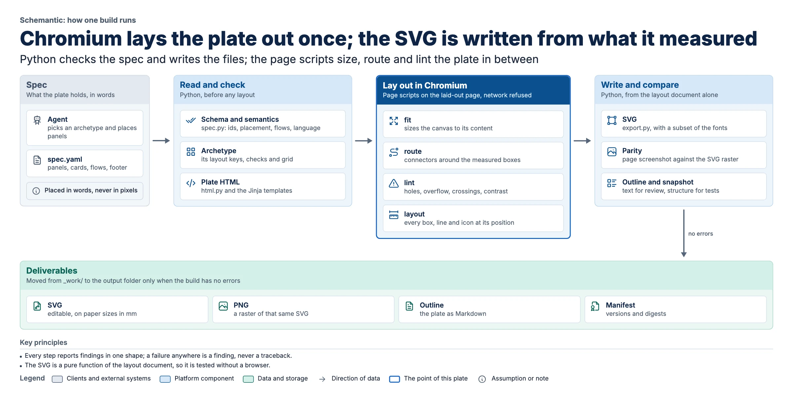

# Architecture

## The pipeline



The plate above is Schemantic drawn by itself, from this page ([`plates/schemantic-pipeline.yaml`](plates/schemantic-pipeline.yaml));
the tests lint it with the examples.

```text
spec.yaml ─► read_spec ─► schema + semantic checks ─► build_html ─► Chromium: fit, decorate, route, lint
          ─► layout document ─► SVG ─► parity (page screenshot vs SVG raster) ─► PNG, outline .md, snapshot
```

`schemantic build` runs all of it in one Chromium session (`schemantic/pipeline.py`); `lint` skips writing the
deliverables. The deliverables (SVG, PNG, outline and a `.build.json` manifest of versions and digests) are written
to `_work/` and move to the output folder only when the build has no errors. Chromium runs with the network refused
(see [`offline.md`](offline.md)). Every step reports findings in one shape (`level`, `check`, `id`, `detail`,
`hint`), and a failure anywhere is a finding, never a traceback.

## Module map

| Module | Does |
| --- | --- |
| `spec.py` | load the YAML, schema check, semantic checks (ids, placement, flows, stories, footer, chips, icons, language, traceability, placeholders) |
| `archetypes/` | one module per body layout; the registry finds them; each knows its layout keys, checks, grid and panel defaults |
| `roles.py` | panel roles: colours from tokens, legend labels, theme roles |
| `html.py` | the template context: grid CSS, legend entries, footer layout, panels with their defaults |
| `browser.py` | launch Chromium the same way everywhere, load a plate, size the canvas, call page scripts |
| `route.py`, `lint.py` | Python sides of the page scripts: problems to findings, lint thresholds |
| `export.py` | the SVG, written from the layout document; font subsetting; the `font` check |
| `images.py` | image diffs (blurred, judged locally) and structural snapshots, read from the layout document |
| `findings.py` | every check, its meaning, fix and hint; generates `references/lint-fixes.md` |
| `outline.py`, `glyphs.py`, `icons.py`, `gallery.py` | the text outline, glyph outlines, icon search, README images |
| `scaffold.py`, `starters/`, `review.py` | for the skill: starter specs per archetype (`new`), and review crops (`--review`) |
| `cli.py`, `doctor.py` | the command line; finding a Python and Chromium (standard library only) |
| `offline.py` | the offline kit: wheels, Chromium, checksums, installer, smoke test |
| `js/` | page scripts: `common` (helpers), `fit`, `decorate`, `route`, `layout`, `lint`, `fonts-ready` |

## The JavaScript and Python boundary

Everything that needs the laid-out page runs in the page: sizing the canvas (`fit`), drawing dashes and strikes
(`decorate`), routing connectors (`route`), measuring for lint (`lint`), measuring the page into a layout document
(`layout`). Python loads the scripts once per page (`browser.open_plate`) and calls each by name with JSON
(`browser.call(page, "route", flows)`), and writes the SVG itself. Visual values come from `schemantic/templates/tokens.css` on
both sides; there is no JavaScript in Python strings.

## The layout document and the paint contract

Between Chromium and the SVG sits one JSON document (`js/layout.js`, saved as `_work/<name>.layout.json`): a tree of
groups, one per element with a kind and an id (panel, card, zone, chip, ...), holding what to draw at the measured
positions:

| Item | Holds |
| --- | --- |
| `group` | `type`, `id`, its `box` (left, top, right, bottom), a label for editors, source `refs`, and its `items` |
| `rect` | `x`, `y`, `w`, `h`, four corner radii, a `fill`, and a `stroke` with its width when all four borders match |
| `line` | one border that differs from the others |
| `text` | one line as Chromium broke it: start `x`, baseline `y`, the text, family, size, weight, colour |
| `icon` | position, size, stroke colour and the icon's SVG |
| `svg` | what the page already drew as SVG: connectors with their labels and step numbers, dashes, strike-throughs |

`export.py` turns it into SVG as a pure function; tests feed it hand-made documents. Each text line is one SVG
`text` element, so the viewer shapes it (kerning, ligatures) with the same embedded font Chromium used.

What a document can describe is the paint contract: backgrounds, solid borders, corner radii, text (family, size,
weight, colour) and icons. While measuring, `layout.js` reports any visible element whose CSS paints something else
(shadows, gradients, transforms, opacity, text-transform, letter-spacing, decoration, italics, outlines, non-solid
borders, `::before`/`::after` content) as a `paint` error, so a theme cannot add what the SVG would drop. Text must
use a bundled family and characters it has (`font`), because the SVG embeds only bundled fonts. A new visual
feature is a decision to extend the contract, the document and the writer together, never CSS alone.

## How the router chooses

For each flow it generates candidates between the two boxes: straight across a shared span (centred, then offset);
L-shapes (one bend); Z-shapes through a gutter channel (two bends); U-shapes out of and back into the same side; and
routes along the body's outer edge. A candidate is clear when every run keeps a margin from every box except the
endpoints and their containers, does not run on top of another route, and does not cross a placed label. The
cheapest clear candidate wins: length, plus 60 px per bend, plus distance off-centre, plus a premium for U-shapes and
outer channels, plus 120 px for every arrow it crosses at a right angle. Flows that can run straight are placed first
with their labels; bent flows follow. When a bent flow finds no clear route, the router repairs: for its three
cheapest candidates that only earlier bent routes block, it takes those up, places the flow and routes them again,
keeping the result only if every route still has a place. After all flows are placed, each bent route that crosses
an arrow is routed once more, now that it can see the routes placed after it, and kept if it crosses fewer. A
crossing the router cannot avoid is an `arrow-crossing` warning.

## Paper

A print size (`a3-landscape`, `a4-landscape`) lays the plate out at the sheet's width at 96 px per inch and as tall as
its content, like a screen plate. `config.paper_fit` then centres it on the sheet, scaled down when it is taller; the
SVG keeps its drawing in CSS px and gets the sheet's size in mm through its root `width`, `height` and `viewBox`, and
the PNG is the plate rasterised at that scale and placed on an exact sheet at `--dpi`. `print-size` fails a plate whose
smallest text, from the layout document, would print under 6 pt.

## Parity and snapshots

`build` screenshots the laid-out page and the rasterised SVG at the same scale and compares them after a 1.5 px blur,
in lightness (a difference over 40) and in colour (the Cb and Cr channels, over 12), so a colour swapped for one of
the same lightness counts; any connected region over 24 px or any 32 × 32 tile over 12 px fails. The tests compare each example's PNG with
`tests/golden/` the same way, and its structure (every element box, text line and connector, rounded to 2 px) with
`tests/snapshots/`; a snapshot diff names the element that moved. `tests/test_metamorphic.py` changes one property
of an example at a time (reverse a flow, add a card, swap two columns, change the language, swap a role colour) and
checks the one effect it must have.

## Adding an archetype

1. Write its section in `references/archetypes.md` and a fictional example in `examples/`.
2. Add `schemantic/archetypes/<name>.py` defining `ARCHETYPE`: its `name`, `required` and `allowed` layout keys,
   `validate` (its own checks), `grid` (a `GridSpec`: rows of panel ids or group names, column tracks, and any
   groups, bands or zones) and `panel_defaults`. The registry finds it; no shared code changes.
3. Add its `layout` keys and an `if/then` block to `schemantic/schema/plate.schema.json`; `tests/test_spec.py` checks that the
   schema and the registry agree.
4. Render CSS in `schemantic/templates/components.css` (and template markup only if it needs a new kind of group).
5. Run `python -m pytest -q --update-golden` for the new example's golden and snapshot, add one negative test per
   layout check, and move the name from planned to built in `SKILL.md` and the README.
