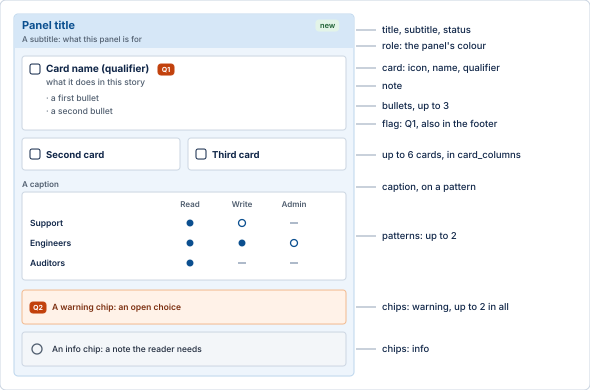
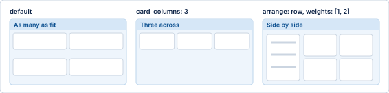
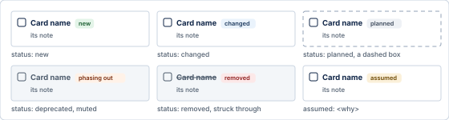
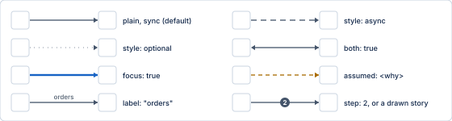
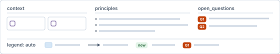

# Layouts

Every layout Schemantic can draw, and every part a panel can hold, as a sketch. The sketches show the idea, not a real plate: the words are placeholders. Each
row links to a finished plate built from a fictional spec. The keys and limits of each layout are in
[`references/archetypes.md`](../references/archetypes.md).

The colours mean the same everywhere: blue for what the team builds or runs, green for data, grey for what is outside its
control, purple for people. A filled header is the one place the plate is about.

Pick on the reader's question. When unsure, use `column-flow`. More than 6 panels or 30 cards is two plates, a series,
each with its own message.

## column-flow

**The reader asks:** How does a request or data get from A to Z?

**Not this when:** Everything hangs off one central part: `hub-and-spokes`.

**Finished plate:** [`examples/orderplatform-toegang.yaml`](../examples/orderplatform-toegang.yaml) ([image](../assets/gallery/orderplatform-toegang.webp))

## hub-and-spokes

**The reader asks:** What sits around the one central thing, and how does it connect?

**Not this when:** There is an order to the parts: `column-flow`.

**Finished plate:** [`examples/orderplatform-eventbus.yaml`](../examples/orderplatform-eventbus.yaml) ([image](../assets/gallery/orderplatform-eventbus.webp))

## layer-cake

**The reader asks:** What builds on what, and what cuts across all of it?

**Not this when:** Layers talk sideways more than up and down: `column-flow`.

**Finished plate:** [`examples/ontwikkelplatform-lagen.yaml`](../examples/ontwikkelplatform-lagen.yaml) ([image](../assets/gallery/ontwikkelplatform-lagen.webp))

## swimlane

**The reader asks:** Who does what, in which order, and where does work change hands?

**Not this when:** It is about systems, not people: `column-flow`.

**Finished plate:** [`examples/incident-swimlane.yaml`](../examples/incident-swimlane.yaml) ([image](../assets/gallery/incident-swimlane.webp))

## nested-zones

**The reader asks:** Where does everything run, and what is inside what?

**Not this when:** The question is how things talk, not where they live: `column-flow`.

**Finished plate:** [`examples/kliniek-zones.yaml`](../examples/kliniek-zones.yaml) ([image](../assets/gallery/kliniek-zones.webp))

## before-after

**The reader asks:** What changes, and what does each part become?

**Not this when:** The change has more than about four parts: a series of plates.

**Finished plate:** [`examples/invoicing-before-after.yaml`](../examples/invoicing-before-after.yaml) ([image](../assets/gallery/invoicing-before-after.webp))

## roadmap

**The reader asks:** What comes when, and where are we now?

**Not this when:** It is who hands work to whom: `swimlane`.

**Finished plate:** [`examples/portal-roadmap.yaml`](../examples/portal-roadmap.yaml) ([image](../assets/gallery/portal-roadmap.webp))

## sequence

**The reader asks:** Who calls whom, in what order, for this one request?

**Not this when:** People hand work over: `swimlane`; it is the whole system: `column-flow`.

**Finished plate:** [`examples/token-check-sequence.yaml`](../examples/token-check-sequence.yaml) ([image](../assets/gallery/token-check-sequence.webp))

## capability-map

**The reader asks:** What can we do, and where are the gaps?

**Not this when:** How the parts talk matters: `column-flow`.

**Finished plate:** [`examples/retail-capability-map.yaml`](../examples/retail-capability-map.yaml) ([image](../assets/gallery/retail-capability-map.webp))

## comparison

**The reader asks:** Which option, and why?

**Not this when:** There is one design and no choice: any other.

**Finished plate:** [`examples/search-engine-comparison.yaml`](../examples/search-engine-comparison.yaml) ([image](../assets/gallery/search-engine-comparison.webp))

## hierarchy

**The reader asks:** What is made of what, or who reports to whom?

**Not this when:** Things have more than one parent: `column-flow`.

**Finished plate:** [`examples/platform-org-hierarchy.yaml`](../examples/platform-org-hierarchy.yaml) ([image](../assets/gallery/platform-org-hierarchy.webp))

## quadrant

**The reader asks:** Where does each thing sit on two axes?

**Not this when:** One axis is time: `roadmap`.

**Finished plate:** [`examples/migration-quadrant.yaml`](../examples/migration-quadrant.yaml) ([image](../assets/gallery/migration-quadrant.webp))

## Inside a panel

Every layout uses the same panels. This one has every part, each named by its field in the spec. The fields, limits and
writing rules are in [`references/spec-guide.md`](../references/spec-guide.md).

A panel's cards take as many columns as fit. `card_columns` sets the number, and `arrange: row` puts its blocks side by side,
patterns first and then the cards, with one number in `weights` for each block.

### Patterns

A panel holds up to two patterns, beside or instead of its cards, in any layout. They suit a layout of boxes best. Where
position carries the meaning (`swimlane`, `roadmap`, `sequence`, `comparison`, `capability-map`, `quadrant`), a pattern sits
under the placed cards and has no step, period, moment or option of its own. A pattern takes room: in a narrow block its text
can overflow, and in a full lane an arrow can lose its route. Lint says so, by name.

| Pattern | | What it shows |
| --- | --- | --- |
| `tier-strip` |  | Tiles in a row, each tier leading to the next: bronze, silver, gold. |
| `process-strip` |  | Numbered steps in a row, inside one panel. |
| `tree` |  | An indented listing: folders, keys, topics. |
| `matrix` |  | Rows against columns, each cell full, partial or none: who may do what. |

## Marks on any layout

A `status` or `assumed` goes on a card, as here, or on a panel, where the tag sits at the right of its header.

Arrows run between cards, or between panels when the sources speak of the whole panel.

| Mark | Means | In the spec |
| --- | --- | --- |
| A filled header, or a heavy blue outline | the one point of the plate | `focus` |
| A tag beside a name | new, changed, planned, phasing out, removed | `status` |
| A dashed box | planned, not built yet | `status: planned` |
| A muted card, or a struck-through name | phasing out, or removed | `status: deprecated`, `status: removed` |
| An amber dashed arrow, or an "assumed" tag | the sources do not say this | `assumed: <why>` |
| A dashed or dotted arrow | asynchronous, or optional | `style: async`, `style: optional` |
| A heavier blue arrow | the one arrow the plate is about | `focus: true` on the flow |
| A head at both ends of an arrow | it runs both ways | `both: true` |
| A number on an arrow | a step in the route the title tells | a story with `draw: true`, or `step` |
| Q1 on a card or chip, again in the footer | an open question | a `warning` chip or card `flag` |
| N1 on a card, again in the footer | a note on that card | a card `flag` of kind `info` |

## The footer

Under the body of every layout. Each part is optional, and `legend: auto` builds the legend from what the plate uses.

